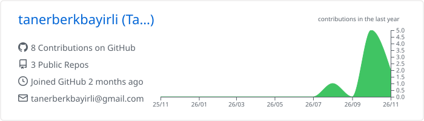
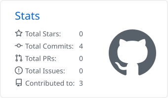
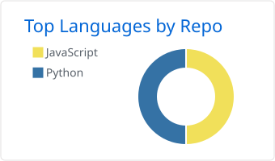
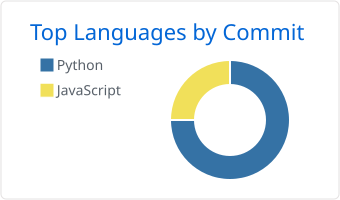

Big Data Analytics student (Manisa Celal Bayar University, TR) building things with Python and AI.

* 🔭 **Current project:** **TxtNote** — a local-first work environment app that makes thesis writing easier for university students. It's a brand-new open-source project, currently in active development.
* 🌱 **Learning:** data structures \& algorithms, statistics, and English (A2 → B1)
* 🎯 **Hobbies:** keeping up with technology, solving my own problems with AI, following AI news and testing newly released models
* ⚡ **Fun fact:** I test AI agents for a living — my own second computer brain runs on one

## 📊 GitHub Stats

&nbsp;

&nbsp;

